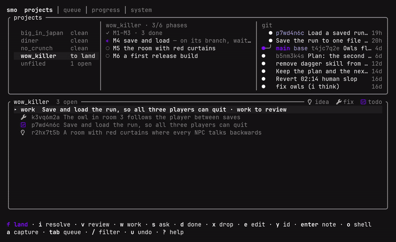

**I build software by directing AI agents, and the tools that keep that work honest.**
Every change is planned first, cross-reviewed by Claude and Codex, tested, and read by me
before it lands. Ten years of programming: web first, then three years of Unity game tech
at a Finnish mobile studio, on the framework, the build pipelines and the tools around
them. Today mostly Rust, on Linux, in the terminal, from Helsinki.
**Open to work**: developer roles in AI-assisted development, Rust and tooling, and game
development; freelance and contract projects too.

smo, my terminal app for working with Claude Code and Codex, on demo data:
capture → plan → work → review → check → land.

##  How I work

Agents write most of my code. I decide what gets built, in what order, and whether it
does what I asked.

- **A note, not a prompt.** One task per note, captured from anywhere on the desktop and
  saved before an agent starts.
- **Ask before work.** Questions run read-only, enforced by how the agent is started, not
  by asking it nicely.
- **Local models where they fit.** Titles and quick read-only questions go to a model on
  Ollama, on my own GPU; Claude and Codex get the plans and the code.
- **A plan, then a second opinion.** Claude drafts and Codex reviews, or the other way
  around; what I accept becomes a numbered decision.
- **One task, one worktree, one branch.** Agents work side by side without touching my
  working copy.
- **Three machines, one routine.** Two desktops and a laptop, at home, at the studio and
  on the go. A session can run on another machine, and notes and handoffs travel through
  git, so I pick up wherever I am.
- **Security is part of the routine.** Every commit is scanned for secrets, and a public
  repo also for private words. Passwords live in a password manager, never in a repo. The
  machines share a private network and back each other up, encrypted and append-only.
- **Checks are the gate.** Format, lint with zero warnings, every test, before anything
  lands. Failed is reported as failed.
- **I read the diff and land it.** Small commits that say why, authored by me; nothing
  merged that I have not seen.
- **A handoff in the repo.** The next session starts from a file, not from a model's memory.

##  smo, in numbers

The tool behind the routine: capture an idea, plan it into milestones, build it phase by
phase, cross-review, gate it on the checks, land it.

| 2,609 | 2,279 | 774 | 36 |
|:-:|:-:|:-:|:-:|
| commits | tests | decisions | days |

As of 2026-10-20. smo is private. The tour isn't.

## Look closer

- **[▶ Play the smo tour](https://site.smolindiedev.workers.dev/smo/#tour)**: the
  dashboard in your browser, about two minutes, with the real keys.
- **[How I work](https://site.smolindiedev.workers.dev/how-i-work/)**: the routine in
  seven steps, each with an example.
- **[Projects](https://site.smolindiedev.workers.dev/projects/)**: smo, Kokko, smol_kino,
  smol_studio, a salon's website, [smol_nvim](https://github.com/Smol-indie-dev/smol_nvim),
  [Type Escape](https://site.smolindiedev.workers.dev/type-escape/), a short game, and the
  site itself.

   
  SMOL CODE, BIG FUN

